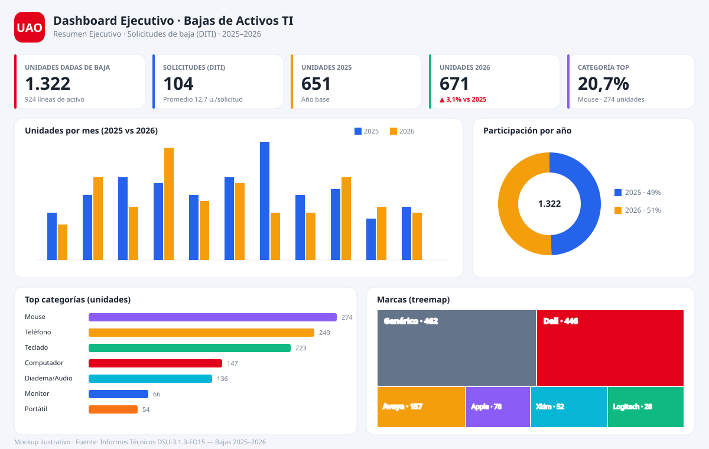
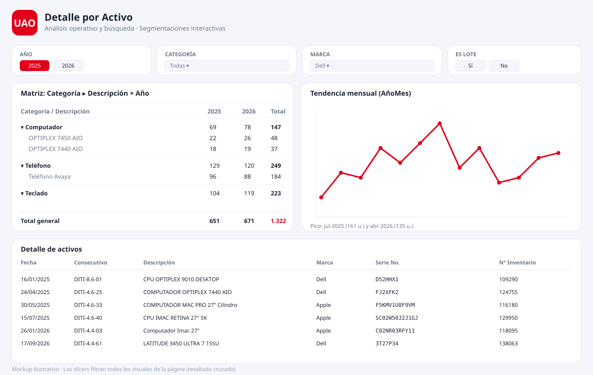
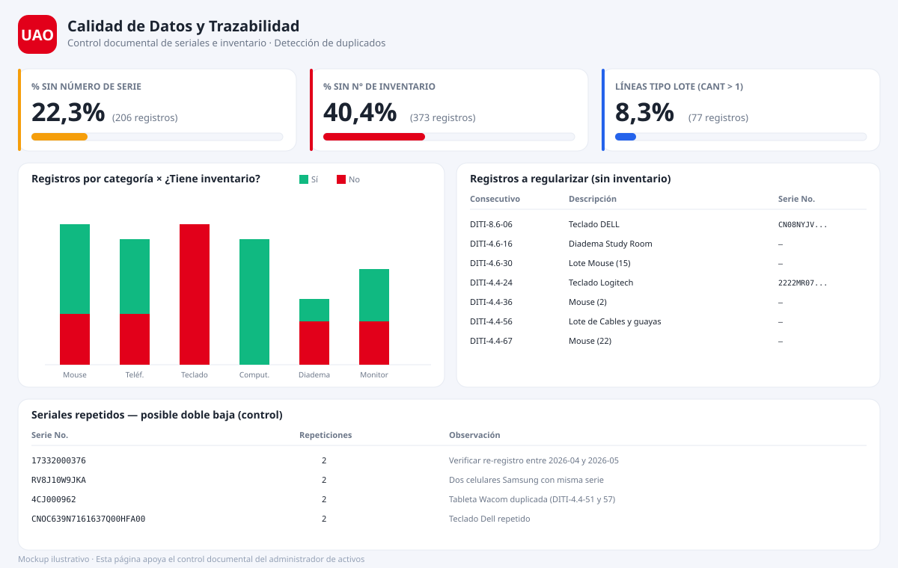

# Armar el `.pbix` paso a paso — Dashboard Bajas de Activos TI (UAO)

> ⚠️ **Nota honesta:** un archivo `.pbix` solo puede generarse de forma fiable dentro de
> **Power BI Desktop** (es un formato binario propietario). Esta guía te lleva de cero a un
> `.pbix` terminado en ~20–30 minutos usando los insumos ya preparados en esta carpeta:
> `tema-uao.json`, `medidas-dax.txt` y el dataset `../data/processed/bajas_consolidado.csv`.

Al terminar tendrás: **BajasActivosTI-UAO.pbix** con 3 páginas interactivas.

> 🎨 **Dos temas incluidos:** `tema-uao.json` (claro) y `tema-uao-oscuro.json` (oscuro).
> 🖼️ **Mockups de referencia:** en la carpeta `mockups/` encontrarás cómo debería verse cada
> página; están insertados en las fases 5, 6 y 7 de esta guía.

---

## Requisitos
- **Power BI Desktop** (gratuito): https://powerbi.microsoft.com/desktop/
- Los archivos de este repositorio descargados en tu equipo.

---

## FASE 1 · Preparar el proyecto (3 min)

1. Abre **Power BI Desktop**.
2. Menú **Archivo → Guardar como** → nómbralo `BajasActivosTI-UAO.pbix`. (Guardar temprano evita perder trabajo.)
3. Aplica el tema corporativo: pestaña **Ver → Temas → Buscar temas…** → selecciona uno:
   - `powerbi/tema-uao.json` → **tema claro** (recomendado para impresión/informes).
   - `powerbi/tema-uao-oscuro.json` → **tema oscuro** (recomendado para pantalla/presentaciones).
   Puedes cambiar entre ambos en cualquier momento sin rehacer visuales.

---

## FASE 2 · Cargar los datos (4 min)

1. **Inicio → Obtener datos → Texto/CSV**.
2. Elige `data/processed/bajas_consolidado.csv`.
3. En la ventana de vista previa:
   - **Origen de archivo** = `65001: Unicode (UTF-8)`.
   - **Delimitador** = Coma.
4. Pulsa **Transformar datos** (abre Power Query).
5. En Power Query, revisa el tipo de cada columna (icono a la izquierda del nombre):
   - `Fecha` → **Fecha** (si quedó como texto: clic en el icono → *Fecha*).
   - `Anio`, `Mes`, `Cantidad` → **Número entero**.
   - Las demás → **Texto**.
6. **Inicio → Cerrar y aplicar**.

---

## FASE 3 · Tabla Calendario y modelo (4 min)

1. **Modelado → Nueva tabla**. Abre `powerbi/medidas-dax.txt`, copia el bloque **PASO 0 ·
   TABLA CALENDARIO** completo y pégalo. Enter.
2. Ve a la vista **Modelo** (icono a la izquierda).
3. Arrastra `Calendario[Date]` sobre `bajas_consolidado[Fecha]` para crear la relación
   (1 Calendario → * bajas). Debe quedar una línea uno-a-varios.
4. En el panel Datos, clic derecho en **Calendario → Marcar como tabla de fechas** → columna `Date` → Aceptar.
5. Selecciona la columna `Calendario[NombreMes]` → pestaña **Herramientas de columnas → Ordenar por
   columna → NroMes**. (Para que los meses salgan en orden, no alfabético.)

---

## FASE 4 · Crear las medidas (5 min)

1. En el panel Datos, clic derecho en `bajas_consolidado` → **Nueva medida**… o usa
   **Modelado → Nueva medida**.
2. Abre `powerbi/medidas-dax.txt` y pega **un bloque por medida** (desde el nombre hasta su cierre).
   Crea al menos estas para el tablero:
   - `Total Unidades`, `Total Registros`, `Total Informes`, `Unidades por Informe`
   - `Unidades 2025`, `Unidades 2026`, `Variacion % 25 vs 26`, `Variacion Etiqueta`
   - `% Sin Serial`, `% Sin Inventario`, `% Con Serial`, `Registros Sin Inventario`
   - `Categoria Top`, `% Participacion Categoria Top`, `Marca Top`, `Total Marcas`
3. *(Opcional, orden)* crea una tabla vacía `_Medidas` (Nueva tabla: `_Medidas = {}`) y
   arrastra todas las medidas allí para tenerlas agrupadas.

---

## FASE 5 · PÁGINA 1 "Resumen Ejecutivo" (6 min)

Renombra la pestaña inferior a **Resumen Ejecutivo** (doble clic en "Página 1").

**Así debería verse esta página:**

### Fila de KPIs (arriba)
Inserta 5 visuales **Tarjeta** (icono de tarjeta en *Visualizaciones*), uno por medida:
`Total Unidades` · `Total Informes` · `Unidades por Informe` · `Unidades 2025` · `Unidades 2026`.
> Tip: para mostrar la variación con flecha, usa una 6ª **Tarjeta** con `Variacion Etiqueta`.

### Gráfico de columnas agrupadas — tendencia por mes y año
- Visual: **Columnas agrupadas**.
- Eje X: `Calendario[NombreMes]` · Leyenda: `Calendario[Anio]` · Valores: `Total Unidades`.
- Título: "Unidades dadas de baja por mes (2025 vs 2026)".

### Gráfico de barras — Top categorías
- Visual: **Barras agrupadas**.
- Eje Y: `bajas_consolidado[Categoria]` · Valores: `Total Unidades`.
- Formato → *Eje Y* → ordenar descendente.

### Gráfico de anillo — participación por año
- Visual: **Anillo (dona)**.
- Leyenda: `Calendario[Anio]` · Valores: `Total Unidades`.

### Treemap — marcas
- Visual: **Treemap**.
- Categoría: `bajas_consolidado[Marca]` · Valores: `Total Unidades`.

---

## FASE 6 · PÁGINA 2 "Detalle por Activo" (4 min)

Nueva página (botón **+** abajo) → renómbrala **Detalle por Activo**.

**Así debería verse esta página:**

### Segmentaciones (slicers)
Inserta 4 visuales **Segmentación de datos**, uno por campo:
`Anio` · `Categoria` · `Marca` · `EsLote`. Colócalas en una franja superior o lateral.

### Matriz
- Visual: **Matriz**.
- Filas: `Categoria` y debajo `Descripcion del elemento`.
- Columnas: `Anio`. Valores: `Total Unidades`.

### Tabla de detalle
- Visual: **Tabla**.
- Campos: `Fecha`, `Consecutivo`, `Descripcion del elemento`, `Marca`, `Serie No.`,
  `No. inventario`, `Cantidad`.

### Línea — tendencia mensual continua
- Visual: **Gráfico de líneas**.
- Eje X: `Calendario[AnioMes]` · Valores: `Total Unidades`.

---

## FASE 7 · PÁGINA 3 "Calidad de Datos" (4 min)

Nueva página → **Calidad de Datos**.

**Así debería verse esta página:**

- 2 **Tarjetas**: `% Sin Serial` y `% Sin Inventario` (Formato → categoría como porcentaje).
- **Columnas apiladas**: Eje `Categoria`, Leyenda `TieneInventario`, Valores `Total Registros`.
- **Tabla**: `Consecutivo`, `Descripcion del elemento`, `Serie No.`, `No. inventario`.
  Agrega un filtro de nivel de visual: `TieneInventario` = No  (para listar lo que falta regularizar).
- *(Opcional)* **Tabla** de seriales repetidos: pon `Serie No.` y `Total Registros`, y filtra
  por `Total Registros` > 1 para detectar posibles dobles bajas.

---

## FASE 8 · Interactividad y acabado (3 min)

1. **Formato → Editar interacciones**: activa el resaltado cruzado entre visuales de cada página.
2. En cada página agrega un **cuadro de texto** con el título y, al pie, la fuente:
   *"Fuente: Informes Técnicos DSU-3.1.3-FO15 — Bajas 2025–2026"*.
3. *(Opcional)* **Insertar → Botones + Marcadores** para alternar vistas "2025 / 2026 / Comparativo".
4. **Archivo → Guardar**. ¡Listo! Tienes tu `BajasActivosTI-UAO.pbix`.

---

## Mantenimiento
Si actualizas los PDF de bajas: reemplaza los CSV en `data/raw/`, ejecuta
`python3 scripts/procesar_bajas.py` (regenera `bajas_consolidado.csv`) y en Power BI pulsa
**Inicio → Actualizar**. Todo el tablero se refresca.
